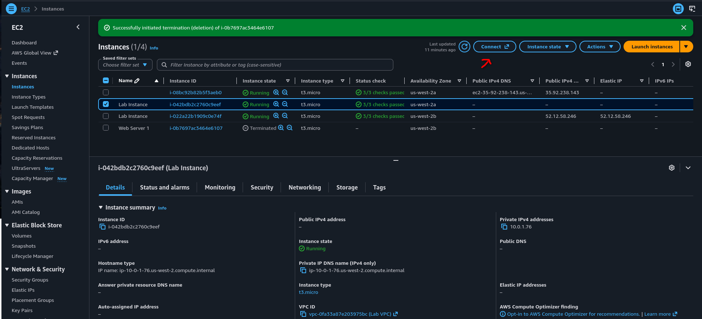
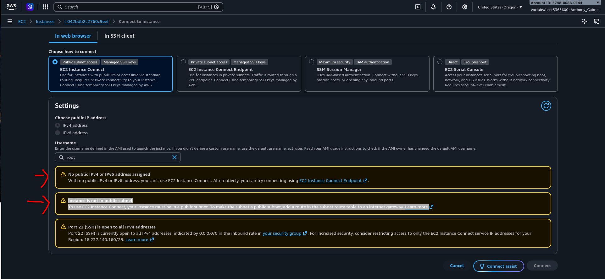
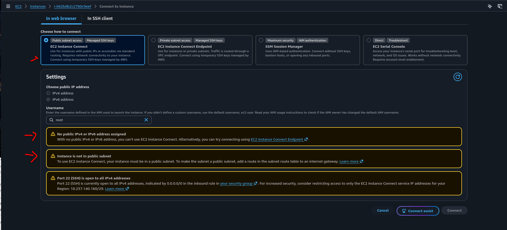
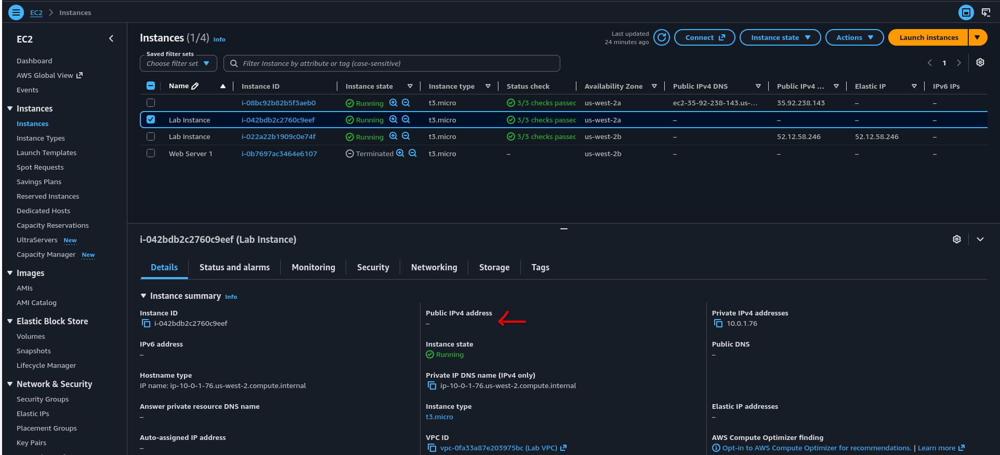
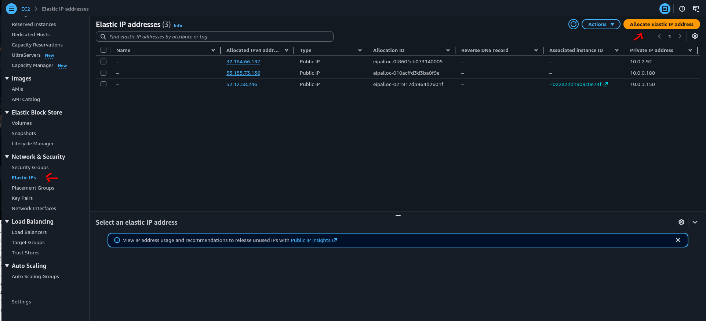
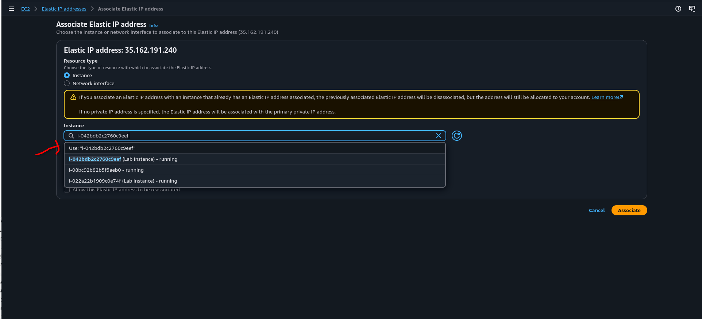
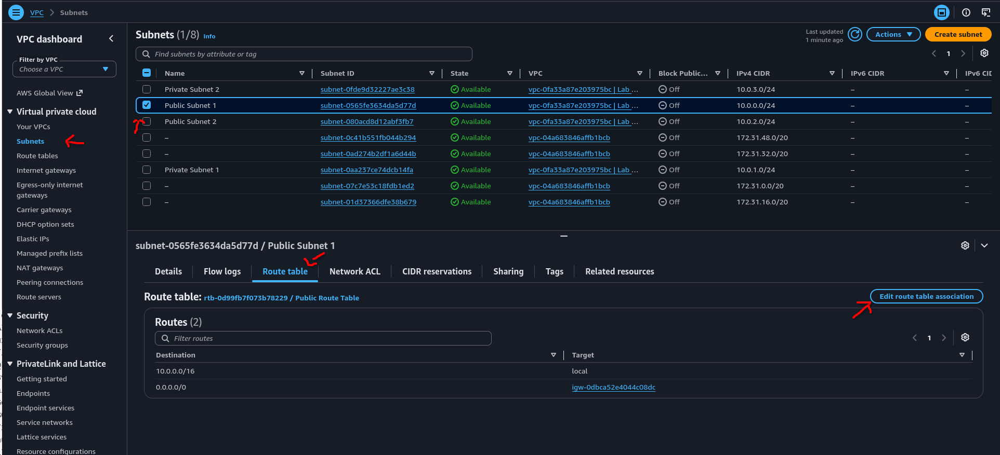
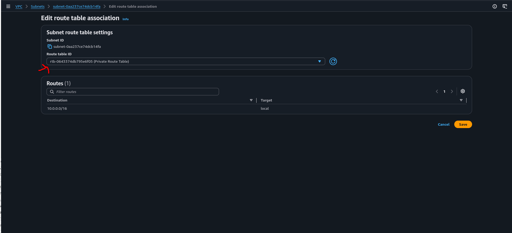
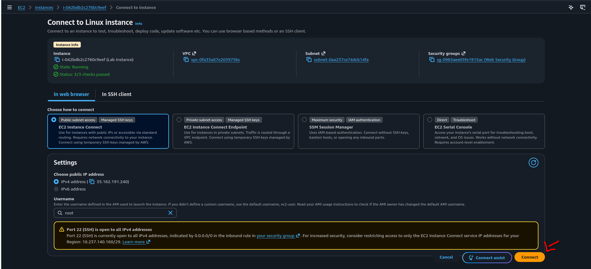

# Optional Challenge: Create an AMI Using the AWS CLI

This optional challenge is for learners who have time remaining after completing the main lab. You will connect to an existing Amazon EC2 instance, configure temporary Vocareum credentials, create an Amazon Machine Image (AMI), and launch a test instance from that image.

## Objective

By the end of this challenge, you will be able to:

1. Troubleshoot an EC2 Instance Connect connection.
2. Configure temporary AWS credentials on an EC2 instance.
3. Create and verify an AMI with the AWS CLI.
4. Launch a test EC2 instance from the AMI.
5. Remove the resources created during the challenge.

## Before You Begin

Make sure that:

- Your Vocareum lab is running.
- You have an existing Linux EC2 instance in the Oregon Region (`us-west-2`).
- The instance is in the `running` state and has passed its status checks.
- You know which instance you want to use to create the AMI.
- The instance has EC2 Instance Connect installed. It is preinstalled on Amazon Linux 2 version `2.0.20190618` or later, standard Amazon Linux 2023, and Ubuntu 20.04 or later.

> **Important:** The screenshots for this lab use the Oregon Region (`us-west-2`). Keep the AWS console and all CLI commands in the same Region. If your instructor assigned a different Region, replace `us-west-2` everywhere with that Region's code.

## Record the Resource Details

In the Amazon EC2 console, select the instance that you will use. Record these values before continuing:

| Value | Example format | Where to find it |
| --- | --- | --- |
| Instance ID | `i-xxxxxxxxxxxxxxxxx` | EC2 **Instances** page |
| Subnet ID | `subnet-xxxxxxxxxxxxxxxxx` | Instance **Networking** tab |
| Security group ID | `sg-xxxxxxxxxxxxxxxxx` | Instance **Security** tab |
| Original route table ID | `rtb-xxxxxxxxxxxxxxxxx` | VPC subnet **Route table** tab |

Do not copy the resource IDs shown in the screenshots. Your IDs will be different.

## Connect to the EC2 Instance

1. In the Amazon EC2 console, choose **Instances**.
2. Select the instance that you want to use.
3. Choose **Connect**.



4. On the **EC2 Instance Connect** tab, select **Connect using a public IP**.



You may see these two blocking errors:

1. **No public IPv4 or IPv6 address assigned**: the instance needs a public address for a browser-based connection over the internet.
2. **Instance is not in a public subnet**: the subnet needs a route to an internet gateway.



The warning that port 22 is open to all IP addresses does not block the connection, but it identifies an unsafe security-group rule. For a browser-based EC2 Instance Connect session, the preferred source is the AWS-managed IPv4 prefix list named `com.amazonaws.us-west-2.ec2-instance-connect`.

> **Lab-only network change:** The next steps expose the instance through a public IP address and change its subnet's route-table association. Follow them only in this temporary, disposable lab. In a production environment, keep private subnets private and use an [EC2 Instance Connect Endpoint](https://docs.aws.amazon.com/AWSEC2/latest/UserGuide/connect-with-ec2-instance-connect-endpoint.html) or another approved private-access method.

### 1. Allocate and Associate an Elastic IP Address

The instance in this lab does not currently have a public IPv4 address.



1. Return to the Amazon EC2 console.
2. In the left navigation pane, under **Network & Security**, choose **Elastic IPs**.
3. Choose **Allocate Elastic IP address**.



4. Keep the default settings and choose **Allocate**.
5. Select the new Elastic IP address and choose **Actions** > **Associate Elastic IP address**.
6. For **Resource type**, select **Instance**.
7. Select the instance whose ID you recorded earlier.
8. Select its private IP address, and then choose **Associate**.



After the association succeeds, return to the instance details and confirm that a value now appears under **Public IPv4 address**.

### 2. Associate the Subnet with the Public Route Table

> **Warning:** A route-table association affects every resource in the subnet. Confirm that you selected the subnet used by your instance, and keep the original route table ID so that you can restore it during cleanup.

1. In the AWS console search bar, enter `VPC`, and open the **VPC** console.
2. In the left navigation pane, choose **Subnets**.
3. Select the subnet ID that you recorded from the instance. In this lab, it is the private subnet that produced the connection error.
4. Open the **Route table** tab.



5. Choose **Edit route table association**.
6. Select the lab's public route table.
7. Before saving, confirm that this route table contains an IPv4 route with:
   - **Destination:** `0.0.0.0/0`
   - **Target:** an internet gateway whose ID begins with `igw-`
8. Choose **Save**.



### 3. Retry EC2 Instance Connect

1. Return to **EC2** > **Instances**.
2. Select the instance and choose **Connect**.
3. On the **EC2 Instance Connect** tab, confirm that the public-address and public-subnet errors are gone.
4. Verify the username shown by the console, and then choose **Connect**.



A browser tab containing a terminal should open. If it does not, see [Troubleshooting](#troubleshooting).

## Configure the Temporary AWS Credentials

Vocareum credentials are temporary and contain three required values: an access key ID, a secret access key, and a session token.

1. In Vocareum, choose **AWS Details**.
2. Next to **AWS CLI**, choose **Show**.
3. Copy the complete `[default]` credentials block.

> **Security:** Do not place credentials in this document, a screenshot, source control, or a chat message. Copy them only into your EC2 terminal. If the lab session expires, obtain a new set and replace all three values.

In the EC2 terminal, create the AWS directory and open the credentials file:

```bash
mkdir -p ~/.aws
nano ~/.aws/credentials
```

Paste the complete block from Vocareum. It will have this structure, but with real values:

```ini
[default]
aws_access_key_id=REPLACE_WITH_THE_VOCAREUM_VALUE
aws_secret_access_key=REPLACE_WITH_THE_VOCAREUM_VALUE
aws_session_token=REPLACE_WITH_THE_VOCAREUM_VALUE
```

In `nano`, press <kbd>Ctrl</kbd>+<kbd>O</kbd>, press <kbd>Enter</kbd> to save, and then press <kbd>Ctrl</kbd>+<kbd>X</kbd> to exit.

Protect the credentials file and configure the default Region and output format:

```bash
chmod 600 ~/.aws/credentials
aws configure set region us-west-2
aws configure set output json
```

Verify that the credentials work:

```bash
aws sts get-caller-identity
```

The command should return your temporary AWS account and role information. Do not continue until it succeeds.

## Set the Lab Variables

Replace each placeholder with the value you recorded earlier. Keep the quotation marks.

```bash
export AWS_REGION="us-west-2"
export INSTANCE_ID="i-REPLACE_WITH_YOUR_INSTANCE_ID"
export SUBNET_ID="subnet-REPLACE_WITH_YOUR_SUBNET_ID"
export SECURITY_GROUP_ID="sg-REPLACE_WITH_YOUR_SECURITY_GROUP_ID"
```

Check the values before using them:

```bash
printf 'Region: %s\nInstance: %s\nSubnet: %s\nSecurity group: %s\n' \
  "$AWS_REGION" "$INSTANCE_ID" "$SUBNET_ID" "$SECURITY_GROUP_ID"
```

## Create the AMI

Create a unique AMI name so that rerunning the challenge does not produce a duplicate-name error:

```bash
AMI_NAME="challenge-ami-cli-$(date +%Y%m%d-%H%M%S)"
```

Create the AMI and save the returned AMI ID in a variable:

```bash
AMI_ID=$(aws ec2 create-image \
  --instance-id "$INSTANCE_ID" \
  --name "$AMI_NAME" \
  --description "AMI created during the AWS CLI challenge" \
  --reboot \
  --region "$AWS_REGION" \
  --query 'ImageId' \
  --output text)

echo "AMI ID: $AMI_ID"
```

The `--reboot` option allows EC2 to reboot the source instance so that its file systems are in a consistent state when the image is created. Your browser-based connection may close during the reboot; this is expected.

Write down the AMI ID. It begins with `ami-`.

## Verify the AMI

AMI creation is asynchronous. Wait until the image reaches the `available` state:

```bash
aws ec2 wait image-available \
  --image-ids "$AMI_ID" \
  --region "$AWS_REGION"

echo "AMI $AMI_ID is available."
```

Display the AMI details:

```bash
aws ec2 describe-images \
  --owners self \
  --image-ids "$AMI_ID" \
  --region "$AWS_REGION" \
  --query 'Images[*].{ID:ImageId,Name:Name,State:State,Created:CreationDate}' \
  --output table
```

If you lose the AMI ID, list the AMIs owned by the lab account:

```bash
aws ec2 describe-images \
  --owners self \
  --region "$AWS_REGION" \
  --query 'Images[*].{ID:ImageId,Name:Name,State:State}' \
  --output table
```

## Launch a Test Instance from the AMI

The following command explicitly supplies the subnet and security group instead of relying on default VPC settings. It also assigns a public IPv4 address because this lab uses a public subnet.

```bash
TEST_INSTANCE_ID=$(aws ec2 run-instances \
  --image-id "$AMI_ID" \
  --count 1 \
  --instance-type t3.micro \
  --subnet-id "$SUBNET_ID" \
  --security-group-ids "$SECURITY_GROUP_ID" \
  --associate-public-ip-address \
  --tag-specifications 'ResourceType=instance,Tags=[{Key=Name,Value=AMI-CLI-Test}]' \
  --region "$AWS_REGION" \
  --query 'Instances[0].InstanceId' \
  --output text)

echo "Test instance ID: $TEST_INSTANCE_ID"
```

Wait for the test instance to pass its status checks:

```bash
aws ec2 wait instance-status-ok \
  --instance-ids "$TEST_INSTANCE_ID" \
  --region "$AWS_REGION"

echo "Test instance $TEST_INSTANCE_ID is ready."
```

In the EC2 console, confirm that the test instance is running and was launched from your AMI. This completes the challenge.

## Troubleshooting

### `ExpiredToken` or `InvalidClientTokenId`

The Vocareum session has probably expired. Restart or refresh the lab, copy the new `[default]` block into `~/.aws/credentials`, and run `aws sts get-caller-identity` again.

### `InvalidInstanceID.NotFound` or the AMI Does Not Appear

The resource and command are probably in different Regions. Confirm that the console is set to Oregon and that `AWS_REGION` is `us-west-2`.

### `InvalidAMIName.Duplicate`

AMI names must be unique within the account and Region. Run the `AMI_NAME` command again to generate a new timestamped name, and then rerun `create-image`.

### `UnauthorizedOperation`

The temporary lab role does not have permission to perform the requested action. Confirm that you copied the current Vocareum credentials. If the error remains, the lab policy may not permit that action; ask your instructor rather than changing IAM permissions.

### The AMI Remains `pending`

AMI creation can take several minutes because EC2 creates snapshots of the attached EBS volumes. Rerun the `describe-images` command and wait. If the waiter eventually reports a failure, inspect the AMI in **EC2** > **AMIs** and review the error shown there.

### EC2 Instance Connect Still Does Not Work

Confirm all of the following:

- The instance is running and has passed its status checks.
- The Elastic IP is associated with the correct instance.
- The instance's subnet uses a route table with `0.0.0.0/0` pointing to an internet gateway.
- The instance security group permits inbound TCP port 22 from the `com.amazonaws.us-west-2.ec2-instance-connect` managed prefix list. In a restricted training lab, use the existing instructor-provided SSH rule if you cannot edit it.
- EC2 Instance Connect is installed on the instance's operating system.
- Your browser or VPN is not blocking the EC2 Instance Connect service.

## Cleanup

Complete these steps after your instructor has checked the challenge. Cleanup prevents unused public IPv4 addresses, instances, and EBS snapshots from remaining in the account.

> **Warning:** Verify every resource ID before running a cleanup command. Terminating an instance and deregistering an AMI are destructive actions.

### 1. Terminate the Test Instance

```bash
aws ec2 terminate-instances \
  --instance-ids "$TEST_INSTANCE_ID" \
  --region "$AWS_REGION"

aws ec2 wait instance-terminated \
  --instance-ids "$TEST_INSTANCE_ID" \
  --region "$AWS_REGION"
```

Do not terminate the original source instance unless your instructor tells you to do so.

### 2. Deregister the AMI and Delete Its Snapshots

```bash
aws ec2 deregister-image \
  --image-id "$AMI_ID" \
  --delete-associated-snapshots \
  --region "$AWS_REGION"
```

If the installed AWS CLI does not recognize `--delete-associated-snapshots`, deregister the AMI in **EC2** > **AMIs**, select **Delete associated snapshots**, and confirm the action.

### 3. Restore the Network Configuration

Use the AWS console to avoid changing the wrong shared network resource:

1. In **VPC** > **Subnets**, select the original instance's subnet.
2. Choose **Route table** > **Edit route table association**.
3. Reassociate the original route table ID that you recorded at the beginning.
4. In **EC2** > **Elastic IPs**, select the address allocated during this challenge.
5. Choose **Actions** > **Disassociate Elastic IP address**.
6. After it is disassociated, choose **Actions** > **Release Elastic IP address**.

## AWS Documentation

- [Prerequisites for EC2 Instance Connect](https://docs.aws.amazon.com/AWSEC2/latest/UserGuide/ec2-instance-connect-prerequisites.html)
- [Add internet access to a subnet](https://docs.aws.amazon.com/vpc/latest/userguide/working-with-igw.html)
- [Configuration and credential file settings](https://docs.aws.amazon.com/cli/latest/userguide/cli-configure-files.html)
- [`create-image` command reference](https://docs.aws.amazon.com/cli/latest/reference/ec2/create-image.html)
- [`run-instances` command reference](https://docs.aws.amazon.com/cli/latest/reference/ec2/run-instances.html)
- [Deregister an AMI and delete associated snapshots](https://docs.aws.amazon.com/AWSEC2/latest/UserGuide/deregister-ami.html)